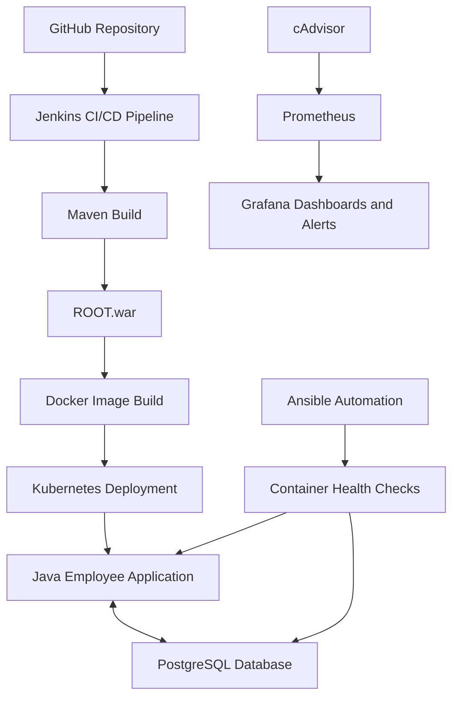

# End-to-End DevOps CI/CD Project – Jenkins, Docker, Kubernetes & Monitoring

## Project Overview

This project demonstrates an end-to-end DevOps workflow for building, containerizing, deploying, monitoring, and managing a Java-based Employee Management application.

The project integrates Jenkins CI/CD automation, Apache Maven, Docker, Kubernetes, PostgreSQL, Ansible, Prometheus, Grafana, and cAdvisor.

The application supports employee record creation and retrieval using a PostgreSQL database.

## Architecture



## Technologies Used

| Technology | Purpose |
|---|---|
| Java | Application development |
| Apache Maven | Build and packaging |
| Apache Tomcat | Java web application server |
| Jenkins | CI/CD automation |
| Git | Version control |
| GitHub | Source code management |
| Docker | Application containerization |
| Kubernetes | Container orchestration |
| PostgreSQL | Relational database |
| JDBC | Java database connectivity |
| JSP and Servlets | Web application development |
| Ansible | Container and application health checks |
| Prometheus | Metrics collection |
| Grafana | Monitoring dashboards and alerting |
| cAdvisor | Container resource monitoring |

## Application Features

The Employee Management System provides:

- Add employee records.
- Retrieve employee records from PostgreSQL.
- Display employee information through a JSP web interface.
- Connect the Java application to PostgreSQL using JDBC.
- Use environment variables for database configuration.
- Validate employee input before inserting records.

## Database Configuration

The application uses:

- Database: `devopsdb`
- Table: `employees`
- Username: Configured through `DB_USER`
- Password: Configured through `DB_PASSWORD`
- Connection URL: Configured through `DB_URL`

Example Docker database connection URL:

```text
jdbc:postgresql://devops-postgres:5432/devopsdb
```

Database credentials are provided through environment variables rather than being hardcoded in the application.

## CI/CD Pipeline

Jenkins automates the application build and deployment workflow.

Pipeline stages:

1. Source code checkout from GitHub.
2. Tool and environment validation.
3. Maven application build.
4. Docker image creation.
5. Importing the Docker image into the Kubernetes environment.
6. Kubernetes configuration validation.
7. Application deployment.
8. Deployment verification.

The Jenkins pipeline helps automate the process of building and deploying application changes.

## Docker

Docker is used to containerize the Java web application and run supporting services.

The project uses containers for:

- Java web application.
- PostgreSQL database.
- Prometheus.
- Grafana.
- cAdvisor.

Docker networking allows the application container to communicate with PostgreSQL through the database container hostname.

## Kubernetes Deployment

The application is deployed to a local Kubernetes cluster.

Implemented components:

- Kubernetes Deployment.
- Two application replicas.
- Kubernetes Service.
- NodePort service configuration.
- Application deployment verification.
- Port forwarding for local access.

Kubernetes manages the application pods and provides service-based access to the deployed application.

## Ansible Automation

Ansible is used to automate application and database health checks.

The playbook `ansible/check-containers.yml` performs the following tasks:

- Checks application container information.
- Verifies that the application container is running.
- Tests the application HTTP endpoint.
- Checks PostgreSQL container information.
- Verifies PostgreSQL container health.

The playbook helps verify the availability of the application and database services.

## Monitoring and Alerting

Prometheus, Grafana, and cAdvisor provide container monitoring.

### Prometheus

- Collects monitoring metrics.
- Scrapes Prometheus and cAdvisor endpoints.
- Provides metrics for monitoring and analysis.

### Grafana

- Visualizes monitoring metrics.
- Provides dashboards.
- Supports alert rules.
- Supports email notifications.

### cAdvisor

- Collects Docker container resource
