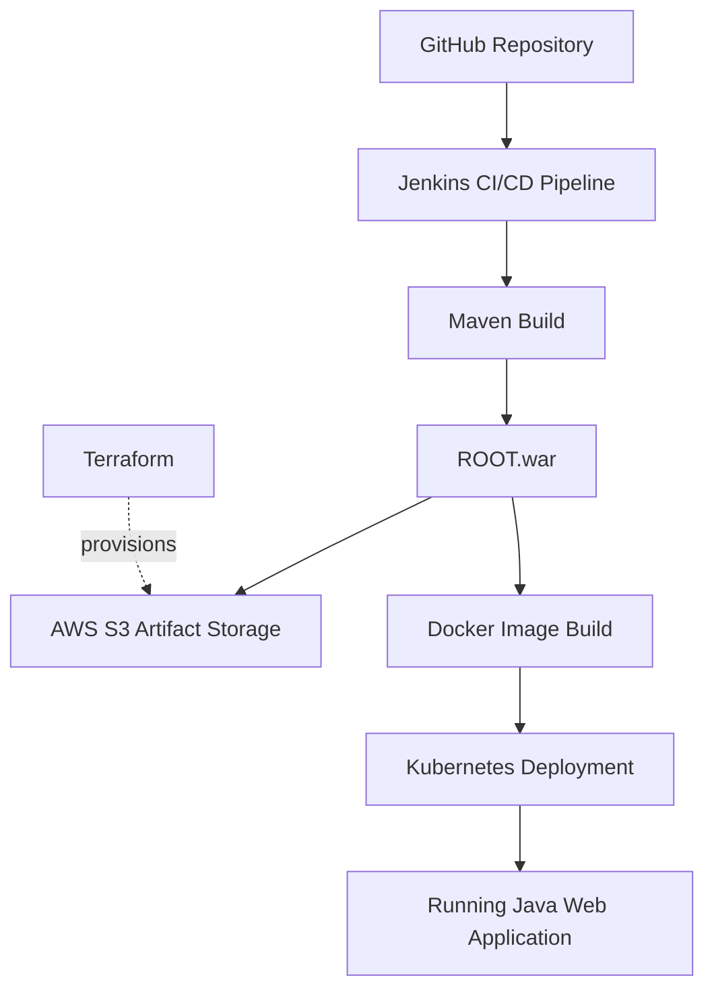

\# End-to-End DevOps CI/CD Pipeline Using Jenkins, Docker, Kubernetes, AWS S3, and Terraform

\## Project Overview

This project demonstrates an automated Continuous Integration and Continuous Deployment (CI/CD) pipeline for a Java web application using Jenkins, Maven, Docker, and Kubernetes. AWS S3 is used to store build artifacts, while Terraform manages the S3 bucket infrastructure.

The pipeline automates application building, artifact storage, Docker image creation, and Kubernetes deployment.

\## Technologies Used

\- \*\*Jenkins\*\* — CI/CD automation

\- \*\*Java 21\*\* — Java development environment

\- \*\*Apache Maven\*\* — Application build and packaging

\- \*\*Docker\*\* — Container image creation

\- \*\*Kubernetes\*\* — Application deployment and management

\- \*\*AWS S3\*\* — Build artifact storage

\- \*\*Terraform\*\* — Infrastructure as Code (IaC)

\- \*\*AWS IAM\*\* — Access control for S3

\- \*\*Git and GitHub\*\* — Source code management

\## Architecture

## Architecture Diagram

\## CI/CD Workflow

1\. \*\*Source Code Management:\*\* The Java application is maintained in GitHub.

2\. \*\*Continuous Integration:\*\* Jenkins retrieves the source code and runs the pipeline.

3\. \*\*Application Build:\*\* Maven compiles and packages the application into `ROOT.war`.

4\. \*\*Artifact Storage:\*\* Jenkins uploads the WAR file to an AWS S3 bucket.

5\. \*\*Docker Image Creation:\*\* Docker packages the application into a container image.

6\. \*\*Kubernetes Image Import:\*\* The Docker image is imported into the local Docker Desktop Kubernetes cluster.

7\. \*\*Deployment:\*\* Kubernetes restarts the application deployment and verifies rollout status.

8\. \*\*Application Verification:\*\* The deployed application is accessed locally through Kubernetes port forwarding.

\## AWS S3 and Terraform

Terraform manages the S3 bucket configuration, including:

\- S3 bucket creation

\- Public access blocking

\- Default server-side encryption using SSE-S3 (AES-256)

\- Resource tagging

The S3 bucket stores build artifacts under the `artifacts/` prefix.

\## Security

\- S3 public access is blocked.

\- Default S3 server-side encryption is enabled.

\- An IAM user and a dedicated policy provide scoped S3 permissions.

\- AWS credentials are stored in Jenkins Credentials rather than hardcoded in the Jenkinsfile.

\- Terraform state files and AWS credentials must not be committed to GitHub.

\## Verification

The following have been verified during project implementation:

\- Maven builds the application successfully.

\- Jenkins pipeline completes successfully.

\- Docker image is built.

\- Kubernetes deployment rollout completes successfully.

\- The application is accessible through the local Kubernetes service.

\- The `ROOT.war` artifact is uploaded to the S3 bucket.

\## Key Learning Outcomes

\- Building an end-to-end CI/CD pipeline

\- Automating Java application builds with Maven

\- Containerizing applications using Docker

\- Deploying and managing applications with Kubernetes

\- Storing build artifacts in AWS S3

\- Provisioning AWS infrastructure using Terraform

\- Applying IAM permissions and basic cloud security practices

\- Troubleshooting CI/CD pipeline and deployment issues

\## Future Improvements

\- Configure a GitHub webhook for automatic pipeline triggering.

\- Add automated unit and integration tests.

\- Introduce code quality and vulnerability scanning.

\- Deploy to a managed Kubernetes service such as Amazon EKS.

\- Add monitoring and alerting.

\## Author

Vidyashree K

DevOps CI/CD Learning Project
